# StockWise AI – Smart Inventory & Shop Management System

**StockWise AI** is a full-stack web-based inventory and shop management application designed to simplify business operations. It provides a centralized platform for managing products, categories, suppliers, stock movements, and sales.

The application also integrates AI-powered services to generate business insights, identify inventory-related issues, provide reorder suggestions, and support smarter business decisions.

---

## Live Application

| Component         | Link                                                                                                   |
| ----------------- | ------------------------------------------------------------------------------------------------------ |
| Live Frontend     | [https://stockwise-ai-frontend.vercel.app/](https://stockwise-ai-frontend.vercel.app/)                 |     |
| GitHub Repository | [https://github.com/princekushwaha207/StockWise-AI](https://github.com/princekushwaha207/StockWise-AI) |

**Deployment Stack:**

- Frontend: Vercel
- Backend: Render
- Database: MongoDB Atlas

---

## Table of Contents

1. [Project Overview](#project-overview)
2. [Problem Statement](#problem-statement)
3. [Project Objectives](#project-objectives)
4. [Key Features](#key-features)
5. [Application Screenshots](#application-screenshots)
6. [Technology Stack](#technology-stack)
7. [System Architecture](#system-architecture)
8. [Data Flow Diagram](#data-flow-diagram)
9. [Database Design](#database-design)
10. [Project Structure](#project-structure)
11. [AI Integration](#ai-integration)
12. [Security](#security)
13. [Installation and Setup](#installation-and-setup)
14. [Deployment](#deployment)
15. [Limitations](#limitations)
16. [Future Enhancements](#future-enhancements)
17. [Learning Outcomes](#learning-outcomes)
18. [Conclusion](#conclusion)
19. [Author](#author)

---

## Project Overview

StockWise AI is developed to provide an integrated solution for inventory and shop management. It allows users to manage product information, maintain supplier records, monitor stock movements, and record sales through a web-based interface.

The system also provides an AI Assistant that helps analyze business information and generate useful recommendations.

The project combines frontend development, backend API development, database management, authentication, cloud deployment, and external AI service integration.

## Problem Statement

Many small shops and businesses still depend on manual records or disconnected applications to manage their inventory and daily sales.

These methods can create several problems:

- Difficulty maintaining accurate inventory records.
- Lack of proper stock movement tracking.
- Time-consuming supplier and product management.
- Difficulty monitoring sales and revenue.
- Delayed identification of low-stock and dead-stock products.
- Limited access to useful business insights.

StockWise AI aims to address these challenges by providing a centralized inventory management platform with AI-assisted business analysis.

## Project Objectives

- Develop a centralized inventory management system.
- Simplify product, category, and supplier management.
- Maintain records of stock-in, stock-out, and stock adjustments.
- Manage and monitor sales transactions.
- Provide a dashboard for business performance visualization.
- Integrate AI services for business analysis and recommendations.
- Implement secure user authentication.
- Deploy the application using cloud-based services.

## Key Features

### 1. User Authentication

- User registration and login.
- JWT-based authentication.
- Password hashing using bcrypt.
- Protected backend operations.

### 2. Dashboard

- Business overview and summary.
- Monthly sales and revenue visualization.
- Daily sales trend.
- Inventory overview.

### 3. Product Management

- Add and manage products.
- Maintain product details and stock information.
- Search and filter products.
- Organize products by category.

### 4. Category Management

- Create and manage product categories.
- Organize inventory into different categories.

### 5. Supplier Management

- Add and manage supplier records.
- Maintain supplier-related information.

### 6. Stock Management

- Record stock-in operations.
- Record stock-out operations.
- Manage stock adjustments.
- Maintain stock movement history.

### 7. Sales Management

- Record sales transactions.
- Maintain sales-related information.
- Track business sales and payment details.

### 8. AI Assistant

The AI Assistant provides intelligent business support through the following features:

- Dead Stock and Expiry Alerts.
- Auto Reorder Suggestions.
- Fraud and Anomaly Detection.
- Total Sales Report.
- Smart Demand Forecasting.
- Business Analysis.
- AI Chat Assistant.

AI-generated results depend on the available application data and connected AI services.

---

## Application Screenshots

This section showcases the main interfaces of StockWise AI.

### 1. Registration Page

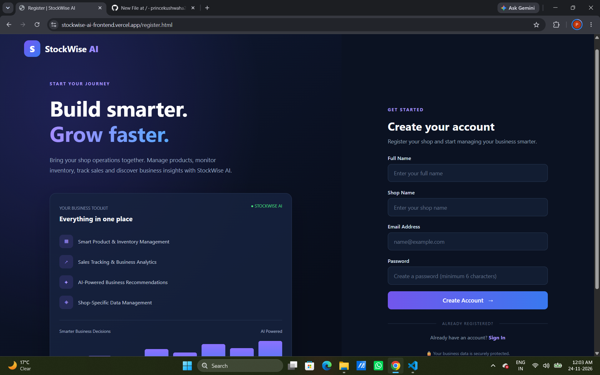


### 2. Login Page

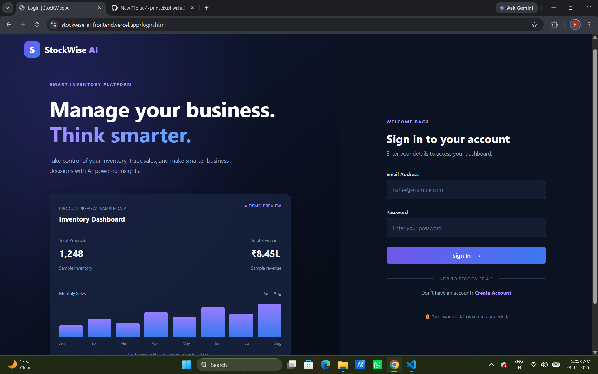

### 3. Dashboard

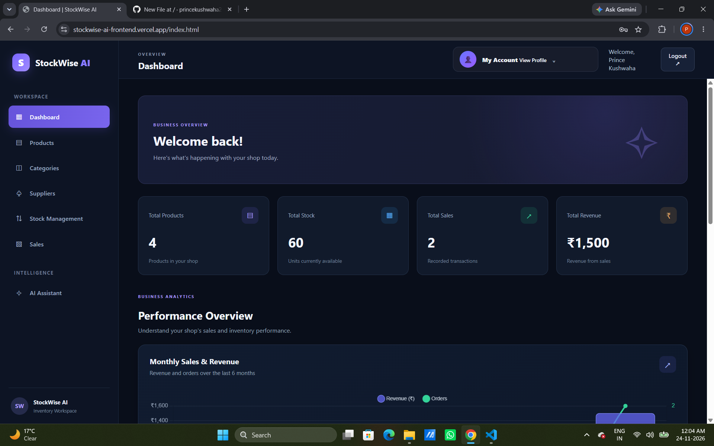

### 4. Product Management

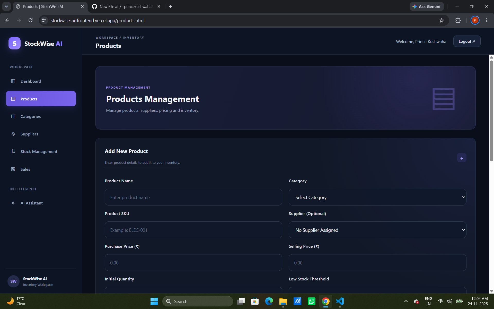

### 5. Category Management

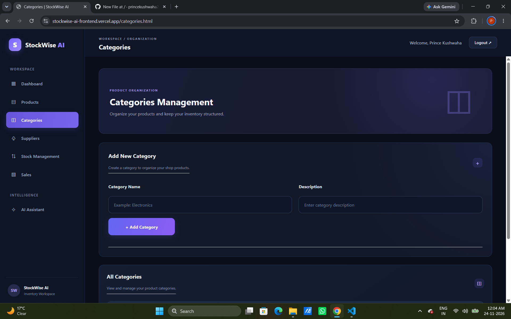

### 6. Supplier Management

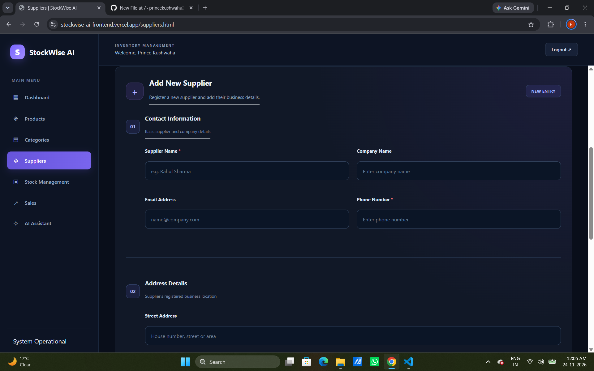

### 7. Stock Management

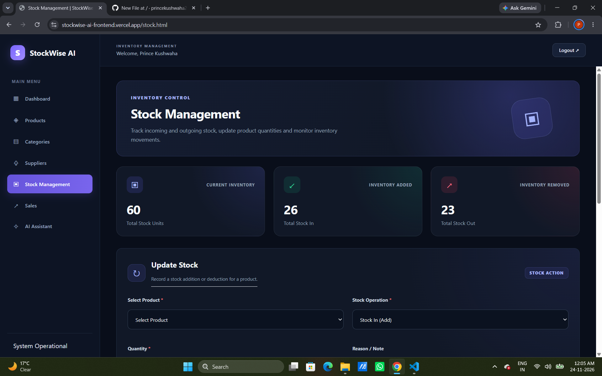

### 8. Sales Management

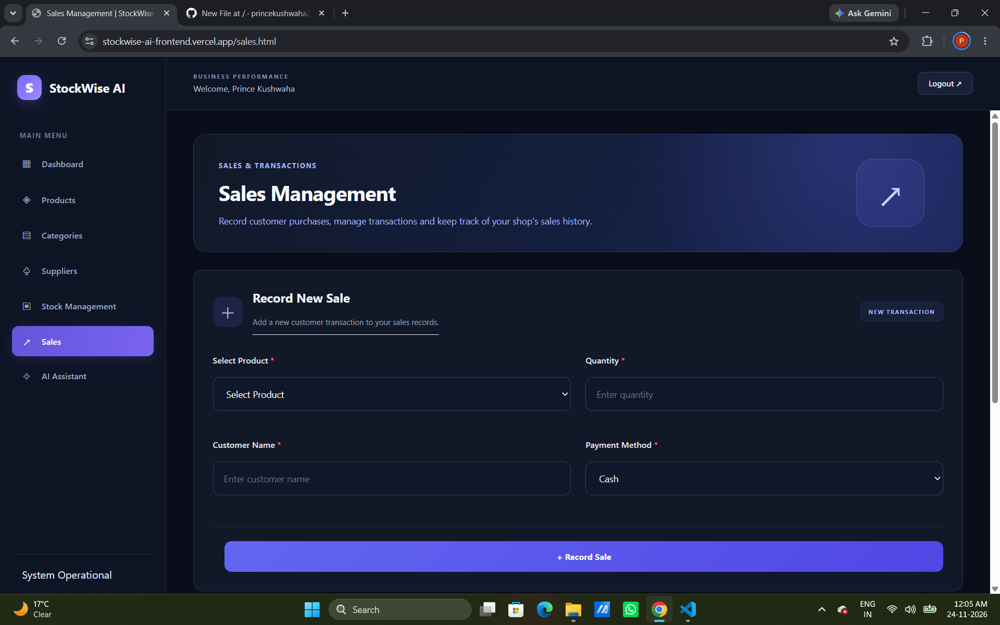


### 9. AI Assistant

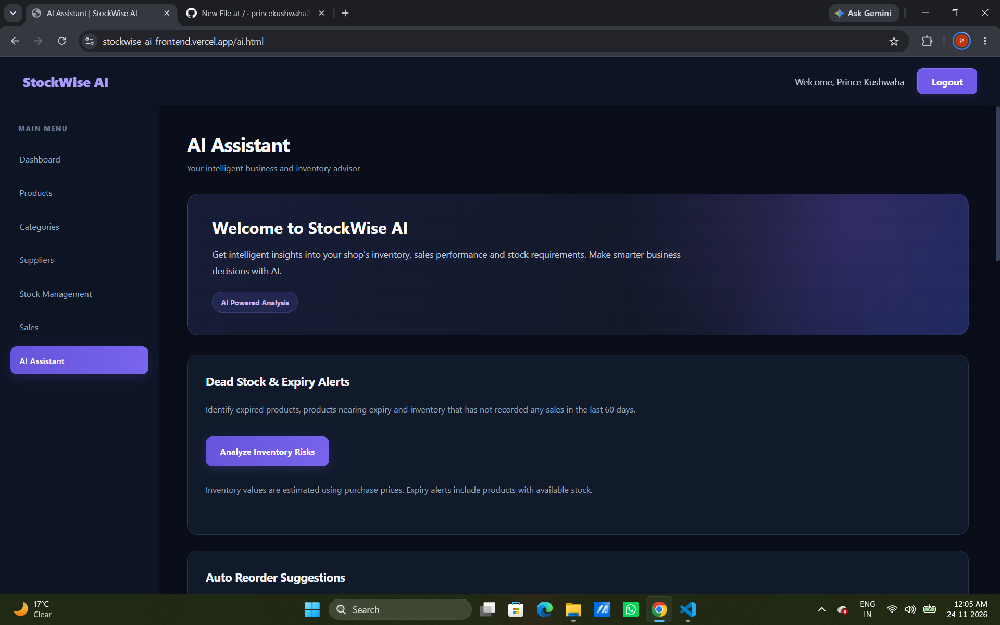

### 10. AI Insights and Recommendations

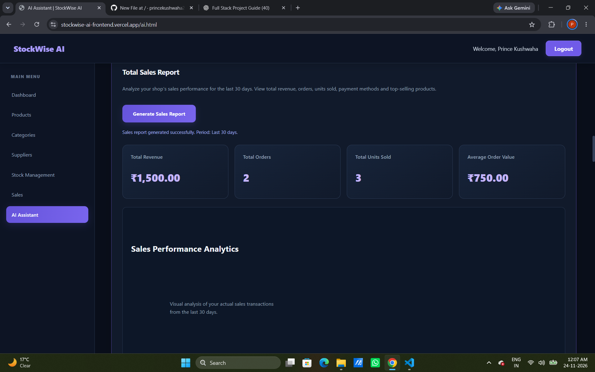

---

## Technology Stack

| Layer              | Technologies                |
| ------------------ | --------------------------- |
| Frontend           | HTML5, CSS3, JavaScript     |
| Backend            | Node.js, Express.js         |
| Database           | MongoDB                     |
| ODM                | Mongoose                    |
| Authentication     | JSON Web Token (JWT)        |
| Password Hashing   | bcrypt                      |
| AI Services        | Google Gemini API, Groq API |
| Data Visualization | Chart.js                    |
| Version Control    | Git, GitHub                 |
| Frontend Hosting   | Vercel                      |
| Backend Hosting    | Render                      |
| Cloud Database     | MongoDB Atlas               |

---

## System Architecture

StockWise AI follows a client-server architecture. The frontend communicates with the backend through API requests. The backend handles business logic, authentication, database operations, and AI service integration.

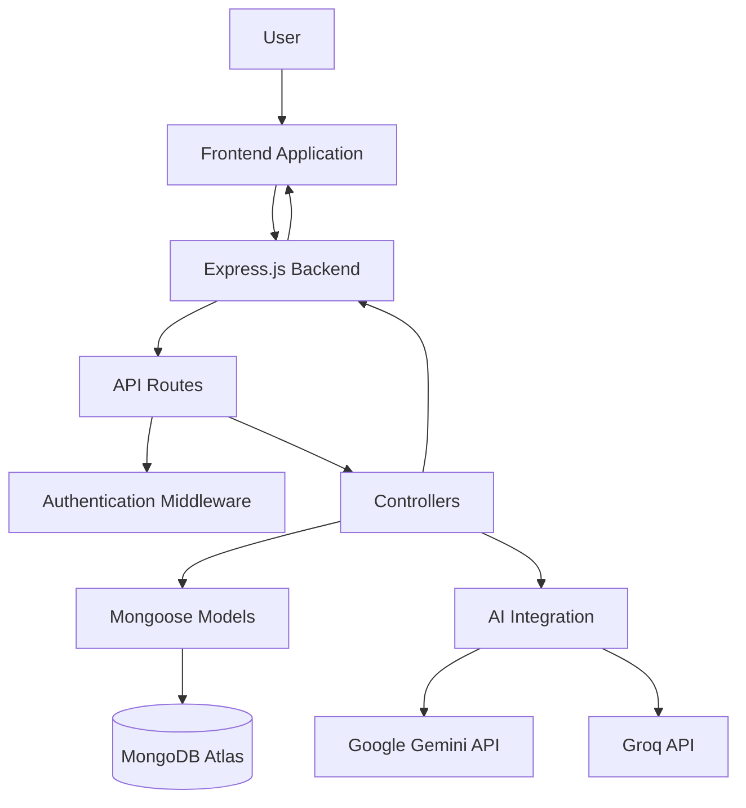

### Architecture Components

1. **Frontend:** Provides the user interface using HTML, CSS, and JavaScript.
2. **Backend:** Handles requests and application logic using Node.js and Express.js.
3. **Routes:** Organize API endpoints for different modules.
4. **Middleware:** Handles authentication and request protection.
5. **Controllers:** Process requests and execute business logic.
6. **Models:** Define database schemas using Mongoose.
7. **Database:** Stores application information in MongoDB Atlas.
8. **AI Services:** Connect to Gemini and Groq for supported AI operations.

## Data Flow Diagram

The following diagram illustrates the major data flows between users, application processes, database storage, and AI services.

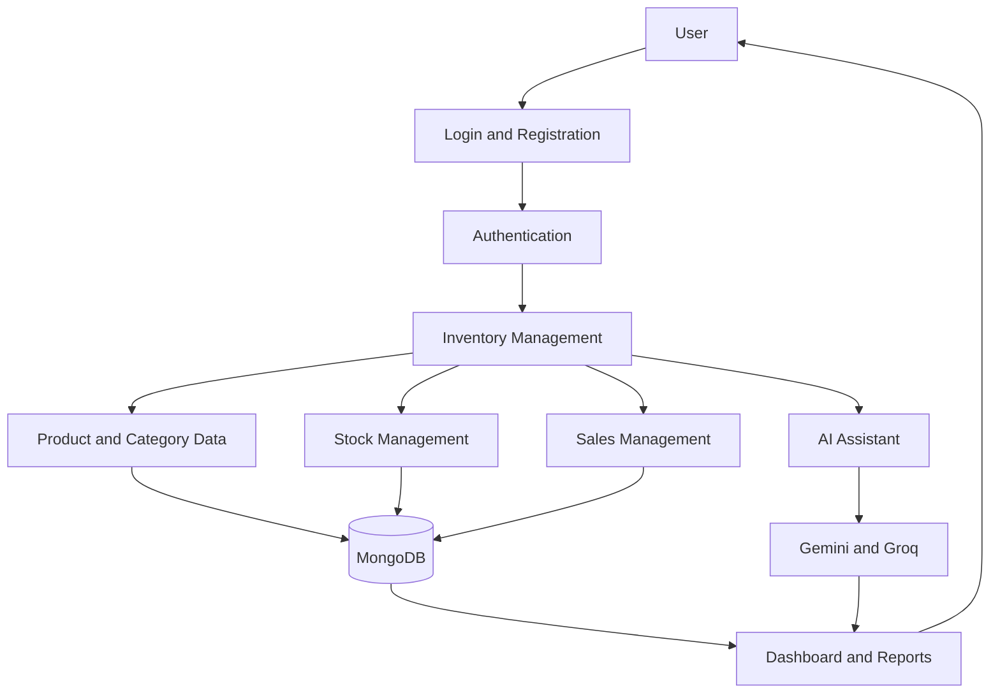

## Database Design

MongoDB is used as the database, while Mongoose provides schema definition and database interaction.

The application contains the following main collections:

| Collection     | Description                          |
| -------------- | ------------------------------------ |
| Users          | Stores user account information      |
| Shops          | Stores shop-related information      |
| Products       | Stores product and inventory details |
| Categories     | Stores product categories            |
| Suppliers      | Stores supplier information          |
| Sales          | Stores sales transaction records     |
| StockMovements | Stores stock movement history        |

These collections support the application's authentication, inventory, supplier, stock, and sales management operations.

---

## Project Structure

The project is divided into two main parts: frontend and backend.

```text
StockWise-AI/
│
├── backend/
│   ├── src/
│   │   ├── config/
│   │   ├── controllers/
│   │   ├── middlewares/
│   │   ├── models/
│   │   ├── routes/
│   │   └── utils/
│   │
│   ├── .env.example
│   ├── package.json
│   └── server.js
│
├── frontend/
│   ├── css/
│   │   └── style.css
│   │
│   ├── js/
│   │   ├── config.js
│   │   ├── auth.js
│   │   ├── dashboard.js
│   │   ├── products.js
│   │   ├── categories.js
│   │   ├── suppliers.js
│   │   ├── stock.js
│   │   ├── sales.js
│   │   └── ai.js
│   │
│   ├── index.html
│   ├── login.html
│   ├── register.html
│   ├── products.html
│   ├── categories.html
│   ├── suppliers.html
│   ├── stock.html
│   ├── sales.html
│   └── ai.html
│
├── screenshots/
│   ├── register.png
│   ├── login.png
│   ├── dashboard.png
│   ├── products.png
│   ├── categories.png
│   ├── suppliers.png
│   ├── stock.png
│   ├── sales.png
│   ├── ai-assistant.png
│   └── ai-insights.png
│
├── .gitignore
└── README.md
```

---

## AI Integration

StockWise AI integrates external AI services to provide intelligent assistance.

### Google Gemini API

Used for supported AI-powered business analysis and intelligent responses.

### Groq API

Integrated as an additional AI service for supported AI operations.

### AI Capabilities

- Business analysis.
- Smart demand forecasting.
- Inventory recommendations.
- Dead stock identification.
- Reorder suggestions.
- AI-based conversations.

AI services require valid API credentials configured through environment variables.

## Security

The application includes the following security measures:

- JWT-based user authentication.
- Password hashing using bcrypt.
- Environment variables for sensitive configuration.
- `.env` files excluded through `.gitignore`.
- Authentication middleware for protected backend operations.
- Database access using configured MongoDB credentials.

**Important:** Database connection strings, API keys, JWT secrets, and passwords must never be committed to the repository.

---

## Installation and Setup

Follow these steps to run StockWise AI locally.

### Prerequisites

Install the following:

- Node.js and npm.
- MongoDB Atlas account or local MongoDB.
- Git.
- Visual Studio Code.
- Live Server extension for frontend development.

### Step 1: Clone the Repository

```bash
git clone https://github.com/princekushwaha207/StockWise-AI.git
```

### Step 2: Open the Project

```bash
cd StockWise-AI
```

### Step 3: Install Backend Dependencies

```bash
cd backend
npm install
```

### Step 4: Configure Environment Variables

Create a `.env` file inside the `backend` directory.

Use the following template:

```env
PORT=5000
MONGODB_URI=your_mongodb_connection_string
JWT_SECRET=your_jwt_secret
GEMINI_API_KEY=your_gemini_api_key
GEMINI_MODEL=gemini-2.5-flash
GROQ_API_KEY=your_groq_api_key
GROQ_MODEL=openai/gpt-oss-20b
```

Replace the placeholder values with your own credentials.

Do not upload the actual `.env` file to GitHub.

### Step 5: Start the Backend

```bash
npm run dev
```

The backend normally runs locally on:

```text
http://localhost:5000
```

### Step 6: Start the Frontend

Open the `frontend` folder in Visual Studio Code.

Run `index.html` using the Live Server extension.

For local development, make sure the API base URL in `frontend/js/config.js` points to your local backend.

---

## Deployment

The project is deployed using cloud-based hosting services.

| Component | Deployment Platform |
| --------- | ------------------- |
| Frontend  | Vercel              |
| Backend   | Render              |
| Database  | MongoDB Atlas       |

### Deployment Workflow

1. The source code is maintained in GitHub.
2. Vercel deploys the frontend from the repository.
3. Render hosts the Node.js and Express.js backend.
4. MongoDB Atlas provides cloud database storage.
5. The frontend communicates with the deployed backend through the configured API URL.

**Live Frontend:** [https://stockwise-ai-frontend.vercel.app/](https://stockwise-ai-frontend.vercel.app/)

**Backend:** [https://stockwise-ai-backend-4uk1.onrender.com/](https://stockwise-ai-backend-4uk1.onrender.com/)

*Note: Render's free hosting service may take some time to respond after a period of inactivity.*

## Limitations

- AI-generated results depend on external AI service availability.
- AI recommendations depend on the quality and availability of application data.
- Free hosting services may have usage restrictions and cold-start delays.
- Some advanced business automation features may require further development.

## Future Enhancements

The following features can be considered for future versions:

- Role-based access control.
- Barcode and QR code scanning.
- Advanced business analytics.
- Automated email and notification alerts.
- Multi-shop and multi-user support.
- Improved AI-based inventory optimization.
- Mobile application integration.
- Additional security and performance improvements.

## Learning Outcomes

This project provided practical experience in:

- Full-stack web application development.
- Frontend development using HTML, CSS, and JavaScript.
- Backend development using Node.js and Express.js.
- REST API development and integration.
- MongoDB database management using Mongoose.
- JWT authentication and password hashing.
- External AI API integration.
- Git and GitHub version control.
- Cloud deployment using Vercel, Render, and MongoDB Atlas.
- Debugging and troubleshooting application issues.

## Conclusion

StockWise AI demonstrates the integration of full-stack web development, database management, and artificial intelligence in a practical inventory and shop management application.

It provides a centralized platform for managing products, suppliers, stock movements, and sales, while AI-powered features support business analysis and inventory-related recommendations.

The project represents practical implementation of software development concepts, API integration, database operations, authentication, and cloud deployment.

---

## Author

**Prince Kushwaha**

**Project:** StockWise AI – Smart Inventory & Shop Management System

**GitHub:** [https://github.com/princekushwaha207/StockWise-AI](https://github.com/princekushwaha207/StockWise-AI)

**Live Application:** [https://stockwise-ai-frontend.vercel.app/](https://stockwise-ai-frontend.vercel.app/)
